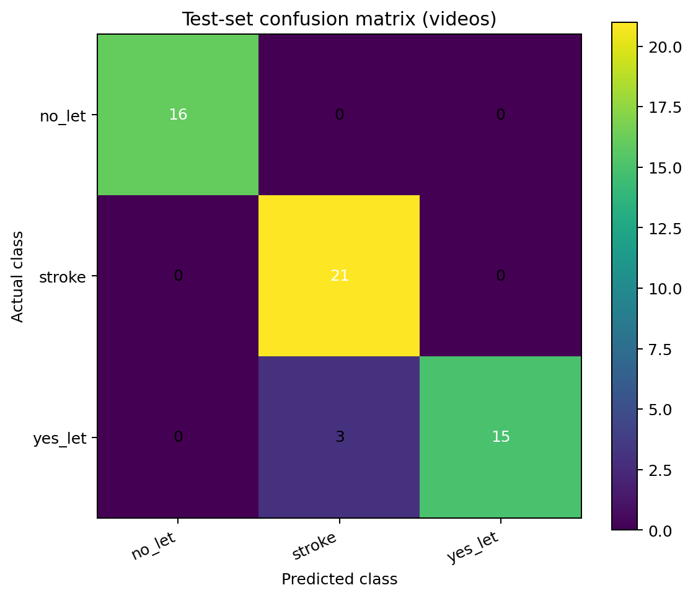
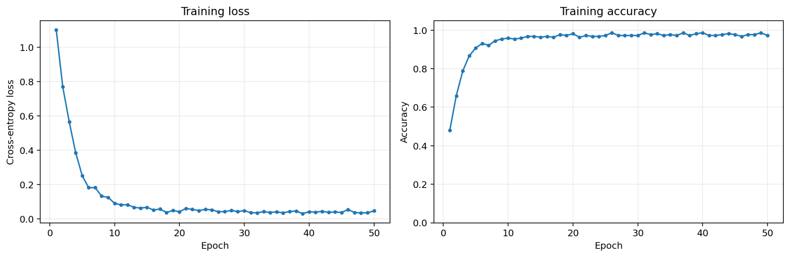

# RALLY --- Squash Video Classification

RALLY classifies squash rally videos into three categories: **No Let**,
**Stroke**, and **Yes Let**. The project includes a Kaggle notebook for
training and evaluation, a saved model checkpoint, and a Streamlit app
for running predictions on new clips.

## Project overview

The project uses a video-level classification pipeline. Each complete
video is represented by a sequence of sampled frames. A pretrained
ResNet50 extracts visual features from each frame, and a GRU processes
the feature sequence to make one prediction for the video.

The training notebook handles dataset inspection, splitting, feature
extraction, model training, evaluation, and export of the model and
evaluation files. The Streamlit app loads the exported checkpoint and
provides a browser interface for classifying uploaded videos.

## Model architecture

``` text
Squash video
    │
    ▼
Uniformly sample 24 frames
    │
    ▼
Pretrained ResNet50
    │
    ▼
2,048 features per frame
    │
    ▼
24-step feature sequence
    │
    ▼
GRU (hidden size 128)
    │
    ▼
Dropout (0.35)
    │
    ▼
Linear classifier
    │
    ▼
Softmax
    │
    ├── no_let
    ├── stroke
    └── yes_let
```

The ResNet50 backbone is pretrained on ImageNet and kept frozen during
training. Its final classification layer is removed, leaving a
2,048-dimensional feature vector for each frame. The GRU and final
linear classifier are trained on the video sequences.

## Repository structure

Keep the following files in the project directory:

``` text
RALLY/
├── app.py
├── notebook.ipynb
├── squash_gru_model.pth
├── requirements.txt
├── metrics.json
├── confusion_matrix.png
├── training_curves.png
├── training_history.csv
└── data_split.csv
```

  -----------------------------------------------------------------------
  File                                Description
  ----------------------------------- -----------------------------------
  `app.py`                            Streamlit interface, video
                                      decoding, model loading, and
                                      prediction

  `notebook.ipynb`                    Kaggle notebook for dataset
                                      preparation, training, evaluation,
                                      and model export

  `squash_gru_model.pth`              Trained GRU/classifier checkpoint
                                      and model metadata

  `requirements.txt`                  Dependencies required to run the
                                      Streamlit app

  `metrics.json`                      Test-set evaluation metrics

  `confusion_matrix.png`              Test-set confusion matrix

  `training_curves.png`               Training loss and accuracy plots

  `training_history.csv`              Per-epoch training loss, accuracy,
                                      and learning rate

  `data_split.csv`                    Video-level training/test split
                                      manifest
  -----------------------------------------------------------------------

## Dataset

The notebook expects the dataset in class-specific folders:

``` text
dataset/
├── no_let/
├── stroke/
└── yes_let/
```

Each folder contains the video clips for that class. The notebook scans
the folders and uses their names as labels. It supports `.mov`, `.mp4`,
`.m4v`, `.avi`, and `.mkv` files.

The supplied split contains **272 videos**, divided into 217 training
videos and 55 test videos. The split is stratified by class and
performed at the video level before frame extraction.

  Class         Training videos   Test videos     Total
  ----------- ----------------- ------------- ---------
  `no_let`                   64            16        80
  `stroke`                   83            21       104
  `yes_let`                  70            18        88
  **Total**             **217**        **55**   **272**

The split uses a test size of 20% and random seed 42. The
`data_split.csv` file records the split, relative video path, class
name, and numeric label.

## Training

Model training is performed in `notebook.ipynb`. The notebook was set up
for a Kaggle environment with the dataset mounted as an input and
generated files written to:

``` text
/kaggle/working/runs/squash_gru/
```

The main training configuration is:

  Setting                                Value
  ------------------------- ------------------
  Backbone                            ResNet50
  Frames per video                          24
  Feature dimension                      2,048
  GRU hidden size                          128
  Dropout                                 0.35
  Epochs                                    50
  Video batch size                           8
  Learning rate                          0.001
  Weight decay                          0.0001
  Optimizer                              AdamW
  Learning-rate scheduler     Cosine annealing
  Random seed                               42

The CNN feature extractor is frozen. Frame features are extracted once
per video and cached, so rerunning the training cells does not require
repeating feature extraction when the cache is valid. Class weights are
used in the cross-entropy loss to account for differences in class
counts.

The notebook exports the checkpoint, metrics, confusion matrix, training
curves, training history, split manifest, per-video predictions, and
classification report.

## Test-set results

The saved evaluation reports results on **55 held-out videos**, with one
prediction per video.

  Metric                                    Score
  ---------------------------------- ------------
  Accuracy                             **94.55%**
  Balanced accuracy                    **94.44%**
  Macro precision                          95.83%
  Macro recall                             94.44%
  Macro F1-score                       **94.75%**
  Weighted F1-score                        94.48%
  Macro ROC-AUC (one-vs-rest)              97.69%
  Matthews correlation coefficient         0.9215

### Per-class results

  Class         Precision    Recall   F1-score   Support
  ----------- ----------- --------- ---------- ---------
  `no_let`        100.00%   100.00%    100.00%        16
  `stroke`         87.50%   100.00%     93.33%        21
  `yes_let`       100.00%    83.33%     90.91%        18

### Confusion matrix

Rows represent actual classes and columns represent predicted classes.
The model correctly classified all No Let and Stroke videos. Three Yes
Let videos were predicted as Stroke.



### Training curves

The model was trained for 50 epochs. The final recorded training loss
was **0.0460**, and the final training accuracy was **97.24%**.



## Running the Streamlit app

The Streamlit app is used for inference on new videos. The notebook is
used for training and evaluation.

### 1. Create a virtual environment

On Windows:

``` powershell
py -m venv .venv
.venv\Scripts\activate
```

### 2. Install dependencies

``` powershell
python -m pip install --upgrade pip
pip install -r requirements.txt
```

### 3. Start the app

``` powershell
streamlit run app.py
```

Open the local URL printed in the terminal.

### 4. Classify a video

1.  Open the **Make a call** page.
2.  Upload a squash video.
3.  Select **Analyse clip**.
4.  View the predicted class and the probability scores for all three
    classes.

The app samples 24 frames from the uploaded clip, extracts ResNet50
features, and passes the sequence through the GRU classifier. The
filename and folder name are not used to produce the prediction.

Supported video decoding depends on the installed PyAV/FFmpeg build.
MP4, MOV, AVI, MKV, and WebM are common formats, but a particular file
may still fail if its codec is unsupported or the file is damaged.

## Model checkpoint

The checkpoint contains the trained GRU and classifier weights, along
with metadata such as the backbone name, feature dimension, frame count,
hidden size, dropout, and class order.

It does **not** contain the pretrained ResNet50 weights. The Streamlit
app loads `ResNet50_Weights.DEFAULT` through Torchvision. An internet
connection may be needed on the first run to download these weights;
later runs can use the local Torchvision cache.

The app uses CUDA if PyTorch detects a compatible CUDA device.
Otherwise, inference runs on the CPU.

## Reproducibility

The notebook and app use 24 sampled frames and the default preprocessing
transform associated with the pretrained ResNet50 weights. The
notebook's frame sampler and the app's inference sampler should be kept
consistent if the model is retrained.

For an exact reproduction, use the same dataset, split seed, Torchvision
version, pretrained weights, frame-sampling procedure, and training
configuration. The notebook uses a file-level random split. If several
clips come from the same original match or recording, they may end up in
different splits because the dataset does not provide source-recording
grouping metadata.

